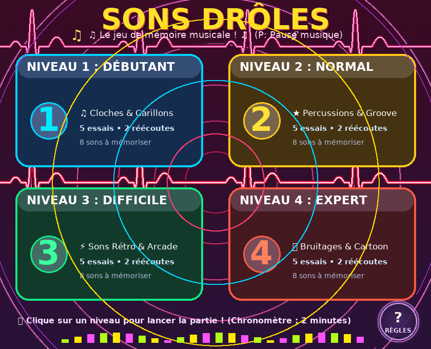
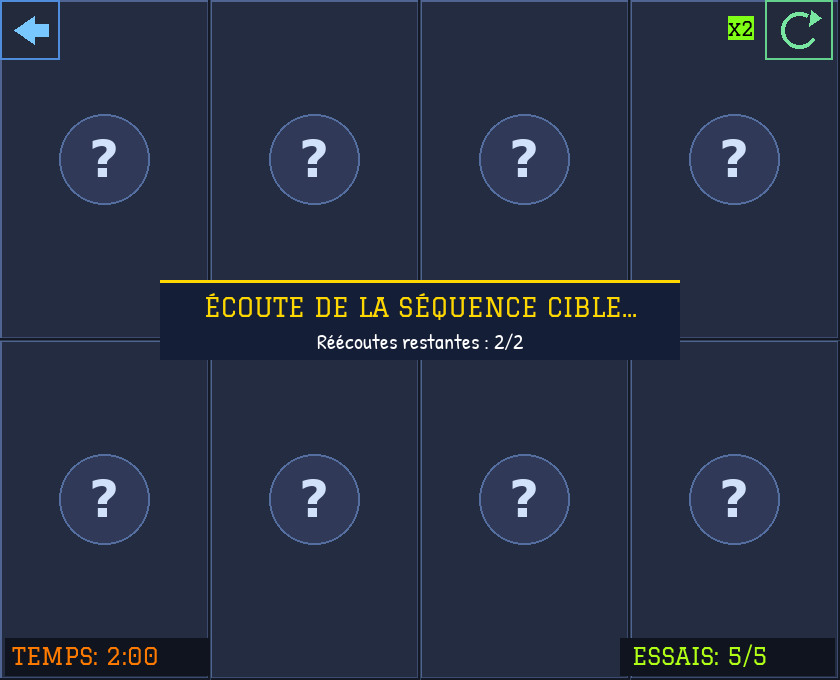
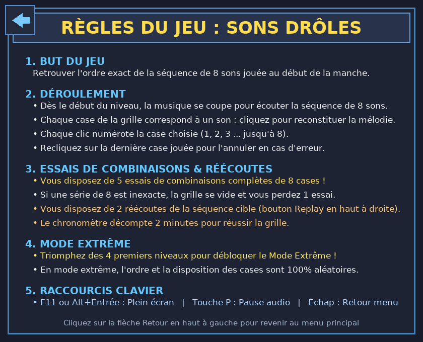

# Sons Drôles 🎵

[](https://github.com/FromTheRags/sons-dr-les/actions/workflows/build.yml)
[](LICENSE)
[](https://isocpp.org/)
[](https://www.libsdl.org/)
[](https://cmake.org/)

> [!NOTE]
> 🚀 **Vous recherchez une version modernisée sous SDL 3 ?** Consultez la branche [`SDL_3`](https://github.com/FromTheRags/sons-dr-les/tree/SDL_3) !
> Tandis que cette branche `main` préserve et modernise l'environnement d'origine en **SDL 1.2 & SDL_ttf**, la branche [`SDL_3`](https://github.com/FromTheRags/sons-dr-les/tree/SDL_3) propose un portage natif sous **SDL 3 & SDL3_ttf** avec accélération matérielle GPU, présentation logique avec letterboxing automatique et nouveau moteur audio `SDL_AudioStream`.

Jeu de mémoire et d'acuité auditive en **SDL 1.2** et **SDL_ttf**, développé en C++17, entièrement portable (**Windows** et **Linux**), compatible avec **CLion**, Visual Studio et GCC/Clang.

---

## 📸 Captures d'écran

| Menu Principal (Pulsation & Niveaux) | Plateau de Jeu (Partie en cours) | Écran des Règles |
| :---: | :---: | :---: |
| <a href="Demo/menu.png"></a> | <a href="Demo/ingame.png"></a> | <a href="Demo/rules.png"></a> |

---

## 🎮 Principe du jeu

Dans **Sons Drôles**, vous devez mémoriser et reconstituer des séquences de sons :
1. **Écoute** : Au début de chaque manche, la musique de fond se coupe et la séquence de 8 sons est jouée.
2. **Reconstitution** : Chaque case de la grille de 8 cases est associée à un son. Cliquez sur les cases dans le bon ordre pour reformer la séquence complète.
3. **Correction** : Vous pouvez annuler votre dernier choix en cliquant à nouveau sur la dernière case sélectionnée.
4. **Essais de combinaisons** : Vous disposez de **5 essais de combinaisons complètes** de 8 cases. Si votre suite de 8 cases est inexacte, la grille se réinitialise et vous perdez 1 essai plutôt que de subir une défaite immédiate.
5. **Réécoutes** : Vous disposez de **2 réécoutes** de la mélodie cible (bouton Replay en haut à droite avec badge).
6. **Chronomètre** : Vous avez 2 minutes pour réussir la grille.
7. **Progression** : Remportez les 4 premiers niveaux pour débloquer le **MODE EXTRÊME** (disposition et ordre entièrement aléatoires) !

### ⌨️ Raccourcis clavier
- **F11** ou **Alt + Entrée** : Activer / désactiver le plein écran (sans déformation, ratio d'aspect préservé)
- **Touche P** : Mettre en pause ou relancer la musique d'ambiance
- **Échap** : Revenir au menu principal ou quitter le jeu

---

## 🛠️ Compilation

### Prérequis Linux (Ubuntu / Debian)
```bash
sudo apt-get update
sudo apt-get install -y libsdl1.2-dev libsdl-ttf2.0-dev cmake ninja-build g++
```

### Compilation (Linux & macOS)
```bash
cmake -B build -G Ninja -DCMAKE_BUILD_TYPE=Release
cmake --build build --config Release
./build/sons-droles
```

### Compilation sous Windows (CLion / MinGW / Visual Studio)
Le projet intègre automatiquement dans `cmake/sdl12/` les en-têtes et bibliothèques précompilées (32 et 64 bits) de SDL 1.2 et SDL_ttf :
1. Ouvrez le dossier du projet dans **CLion** ou chargez le fichier `CMakeLists.txt`.
2. Configurez le profil de compilation (Release ou Debug).
3. Lancez la cible `sons-droles`. Les bibliothèques dynamiques (DLL) et les ressources (`assets/`) sont automatiquement copiées dans le répertoire de sortie de l'exécutable lors de la phase post-build.

---

## 📦 Structure du projet

```
.
├── .github/workflows/          # CI/CD GitHub Actions (Linux & Windows)
├── assets/                     # Ressources du jeu libres de droits
│   ├── fonts/                  # Polices sous licence SIL Open Font License (OFL)
│   ├── images/                 # Arrière-plans et cases du jeu au format BMP
│   └── sounds/                 # Sons et musiques générés au format WAV (CC0/MIT)
├── cmake/
│   ├── sdl12/                  # Bibliothèques SDL 1.2 et SDL_ttf pour Windows
│   └── CopyRuntimeDependencies.cmake
├── innosetup/                  # Script d'installation Inno Setup pour Windows
├── source/                     # Code source C++ réorganisé et modulaire
│   ├── common.h                # Types communs, configurations de plateformes
│   ├── assets.h / assets.cpp   # Gestionnaire et cache des ressources
│   ├── audio.h / audio.cpp     # Moteur audio SDL 1.2 natif (mixage WAV)
│   ├── renderer.h / .cpp       # Rendu graphique, fenêtrage, mise à l'échelle
│   ├── game.h / game.cpp       # Logique des niveaux, règles et progression
│   └── main.cpp                # Point d'entrée et boucle d'événements
├── tools/
│   └── generate_assets.py      # Générateur autonome de sons et d'images
├── CMakeLists.txt              # Configuration CMake moderne
├── LICENSE                     # Licence GNU GPLv3
├── OFL.txt                     # Licence Open Font License
└── README.md
```

---

## 📜 Licences & Droits d'auteur

- **Code source** : Sous licence [GNU General Public License v3.0 (GPLv3)](LICENSE), Copyright (C) 2013-2026 FromTheRags.
- **Ressources sonores & graphiques** : 100% libres de droits, créées spécifiquement pour le projet et reproductibles via `tools/generate_assets.py`.
- **Polices typographiques** : Sous licence **SIL Open Font License 1.1** (Graduate & Patrick Hand par Google Fonts, DejaVu Sans).

---

> 💡 *Pour découvrir la version modernisée utilisant SDL 3, basculez sur la branche [`SDL_3`](https://github.com/FromTheRags/sons-dr-les/tree/SDL_3).*
